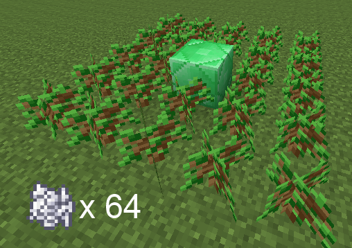

# GiantTreesX

[](https://modrinth.com/project/gianttreesx) [](https://def9a2a4.github.io/discord.html) [](https://def9a2a4.github.io/GiantTreesX/)

A Minecraft plugin that grows enormous, procedurally generated trees: giant oaks and spruces, mangroves on stilt roots, pale oaks hung with moss, autumn poplars, huge mushrooms and nether fungi. Grow them from saplings with bone meal, summon them with a command, or let them spawn in new chunks. Every tree is different, and none of it needs a client mod or resource pack.

**[Browse every tree in 3D in the gallery and viewer](https://def9a2a4.github.io/GiantTreesX/)**: look at them block by block, cut into them, try the wood styles, and edit tree files in your browser.

GiantTreesX is maintained by [def9a2a4](https://github.com/def9a2a4). It is a fork of [GiantTrees](https://github.com/rmichela/GiantTrees) by Ryan Michela, updated for current Paper with new trees, three tree sizes, configurable natural spawning and much faster placement. Report bugs on the [GiantTreesX issue tracker](https://github.com/def9a2a4/GiantTreesX/issues), not upstream.

|                    Oak                     |                      Pale Oak                      |                     Mangrove                     |                    Cherry                    |
| :----------------------------------------: | :------------------------------------------------: | :----------------------------------------------: | :------------------------------------------: |
|      |    |  |  |
|                 **Poplar**                 |                  **Red Mushroom**                  |                **Crimson Fungus**                |                  **Spruce**                  |
|  |  |  |  |

**WARNING:** BACK UP YOUR WORLD. Giant trees replace a lot of blocks, and there is no undo.


# Features

- **18 tree types**: oak, birch, spruce, jungle, acacia, dark oak, cherry, mangrove, pale oak, swamp oak, cottonwood, mesa puzzle, azalea, poplar (26.3+), red and brown mushrooms, crimson and warped fungi.
- **Three sizes of each**: giant (40 to 60 blocks tall), huge (25 to 40) and big (about 14 to 24). Jungle and spruce have no big tree; vanilla's 2x2 trees fill that size.
- **Decorations**: vines on jungle trunks and on mangrove and swamp oak leaves, pale moss under pale oaks, weeping vines under crimson fungi, muddy mangrove roots, and vanilla-style rooted dirt and hanging roots under azaleas.
- **Wood styles**: build trunks from logs only, or with bark on the outside and plain or stripped logs in the core. Trunks can be hollow. Any wood type can get its own style and a weighted mix of leaf blocks.
- **Leaves decay like vanilla**: chop a tree's wood and its leaves fall away. Hidden wood inside large leaf clusters keeps the canopy alive until then.
- **Natural spawning**, configured per biome: which trees, how often, and in which sizes. Azaleas spawn above lush caves, like vanilla.
- **Gentle on the server**: trees are worked out off the main thread and placed from the bottom up in small batches.
- **Safe**: trees never replace chests, spawners or other block entities, or any block you list in `protected_blocks`.
- **Custom trees**: design your own in the [web viewer](https://def9a2a4.github.io/GiantTreesX/viewer/) and drop the file in `plugins/GiantTrees/tree/`.

## Growing Trees

1. Clear a 5x5 area of dirt or grass.
2. Put the core block in the middle: an emerald block for a giant or huge tree, a bone block for a big one.
3. Plant saplings around it in the tree's pattern.
4. Right-click the core block holding bone meal. The bone meal it costs is taken from your inventory.
5. Stand back: particles spread out to the width of the trunk, and the tree appears after 3 seconds.

| Size  | Core block    | Saplings around it   | Bone meal | Tree file              |
| ----- | ------------- | -------------------- | --------- | ---------------------- |
| giant | emerald block | two full rings (5x5) | 64        | `tree.<NAME>.xml`      |
| huge  | emerald block | one full ring (3x3)  | 32        | `tree.<NAME>_HUGE.xml` |
| big   | bone block    | one full ring (3x3)  | 16        | `tree.<NAME>_BIG.xml`  |

Most trees use their own sapling all round. Mixed patterns (mesa puzzle: acacia and oak; cottonwood: birch and oak; swamp oak: oak with blue orchids; azalea: azalea and flowering azalea), the mushrooms and the fungi are listed with every pattern in [`config.yml`](src/main/resources/config.yml). Patterns match in any rotation. Mushrooms follow vanilla's placement rules: dim light, or mycelium, podzol or nylium underneath. Server owners can change the bone meal costs (0 makes a size free), turn a size off (a 5x5 ring then grows the huge tree of its inner ring), or turn growing from saplings off altogether, in the `planting:` section of `config.yml`.



## Natural Trees

Trees spawn in newly generated chunks. The `natural:` section of `config.yml` sets where, how often and which trees; a tree name grows every size of that tree:

```yaml
natural:
  enabled: true
  worlds: [world]
  chance: 4                       # percent of new chunks that grow a tree
  sizes: {giant: 1, huge: 4, big: 16}
  trees:
    FOREST: [OAK, COTTONWOOD]
    PALE_GARDEN: [PALE_OAK]
    LUSH_CAVES: [AZALEA]          # above lush caves, in any biome
    PLAINS:                       # a biome can also set its own chance, weights and sizes
      chance: 0.2
      trees: {OAK: 3, BIRCH: 1}   # 3 oaks for every birch
      sizes: {giant: 0}           # no giant trees here
```

By default each biome grows 16 big and 4 huge trees for every giant. Natural trees grow only on soil, never on or in another tree, and in water only in swamps. Biome variants share their biome's entry (`FOREST` also covers flower and windswept forests) unless you give them their own. Unknown tree or biome names are logged at startup.

## Commands

`/gianttrees`, or `/gt` for short. Every argument tab-completes, and leaving one out shows clickable choices: `/gt grow` lists the tree types, clicking one lists its sizes, and clicking a size grows it where you stand.

| Command                                      | Description                                                              | Permission                            |
| -------------------------------------------- | ------------------------------------------------------------------------ | ------------------------------------- |
| `/gt help`                                   | List the commands, with links to the gallery, GitHub and Discord         | everyone                              |
| `/gt grow <type> <size>`                     | Grow a tree where you stand, e.g. `/gt grow pale_oak huge`               | `gianttrees.create` (default: op)     |
| `/gt grow <type> <size> <x> <z> [world]`     | Grow a tree at a position; from the console, give the world too          | `gianttrees.create` (default: op)     |
| `/gt edit <type> <size> [root]`              | Open a tree file in the Arbaro desktop editor (console only, needs a display) | console                          |
| *(right-click a sapling pattern with bone meal)* | Grow a tree from saplings                                            | `gianttrees.grow` (default: everyone) |

Types are the bundled trees plus any in `plugins/GiantTrees/tree/` (`tree.PALE_OAK_HUGE.xml` is type `pale_oak`, size `huge`); sizes are `giant`, `huge` and `big`.

## Custom Trees

Trees are [Arbaro](https://arbaro.sourceforge.net/) parameter files: `tree.<NAME>.xml` for the tree and an optional `tree.<NAME>.root.xml` for its roots, which grow upside down below it.

The easiest way to make one is the **[web viewer](https://def9a2a4.github.io/GiantTreesX/viewer/)**. Start from any bundled tree, change its parameters and watch it regenerate as Minecraft blocks, then *Download XML*. Put the file in `plugins/GiantTrees/tree/` with a name in capitals, and it works with `/gt grow` straight away. A file there with a bundled tree's name (`tree.OAK.xml`) replaces that tree; delete it to go back to the bundled one. To make it spawn, list its name under a biome in `natural.trees`; to grow it from saplings, add a pattern to `planting.patterns`. To tune a tree for one biome only, give it its own file (`tree.OAK_PLAINS.xml`) and list that.


# Installation

## Requirements

- **Paper 1.21.4 through 1.21.11, or 26.1 through 26.3** (one jar), or a Paper fork. CI runs on 1.21.11 and 26.3. Poplar trees need 26.3; on older servers they grow as birch and the poplar patterns are skipped.
- **Java 21 or newer.** Minecraft 26.x servers themselves require Java 25.
- **Spigot and Folia are not supported.**

No other plugins are needed.

## Install

1. Download `GiantTrees-<version>.jar` from [Modrinth](https://modrinth.com/project/gianttreesx).
2. Put it in your server's `plugins` folder.
3. Restart the server.

GiantTreesX reports anonymous usage statistics to [bStats](https://bstats.org/plugin/bukkit/GiantTreesX/35220) (server count, Minecraft and Java versions). Server owners can turn it off for all plugins in `plugins/bStats/config.yml`.

The plugin folder is `plugins/GiantTrees/`: `config.yml`, and a `tree/` folder for trees you add or replace. The bundled trees stay inside the plugin jar, so updates bring their latest versions.

## Upgrading from GiantTrees

The config has a new layout: natural spawning settings are in a `natural:` section and planting settings in a `planting:` section. Old settings (`naturallyGrowTrees`, `worlds`, `treeGrowthPercentChance`, `planting-patterns`, `core`, `bone-meal-consumed`, ...) are no longer read, and the plugin warns at startup while they are in your `config.yml`; until you move them, the defaults apply. The easiest way is to delete `config.yml`, restart to get the new one, and copy your changes back in.

Trees grown before the update keep their old leaves, which never decay.

Tree files are no longer unpacked into the plugin folder, and the old `tree.*.xml` and `biome.*.xml` files there are no longer read. The plugin warns at startup while they are there, naming the ones that differ from the bundled trees. Move those you want to keep into `plugins/GiantTrees/tree/` (rename a `biome.BIOME-NAME.xml` to `tree.NAME.xml` and list `NAME` under its biome in `natural.trees`), then delete the rest.


# Configuration

Everything is in `plugins/GiantTrees/config.yml`, and every setting is explained in the [bundled copy](src/main/resources/config.yml). Restart the server after changing it.

- **Natural spawning** (`natural:`): `enabled`, `worlds`, `chance`, `sizes` (how often each size spawns; 0 turns one off) and `trees` (per biome)
- **Growing from saplings** (`planting:`): `enabled`, `sizes` (`false` turns a size off), `particles` (shown while the tree is on its way), `bone-meal` (cost per size), `core` (the middle block per size) and `patterns`
- `generation-delay`: seconds before a tree grown from saplings or with `/gt grow` appears
- **Looks**: `wood` (`style`: `all_log`, `mixed` or `mixed_log`; `hollow_chance`; `hollow_wall_thickness`) and `wood_types` (the same per wood type, plus a weighted `leaves` mix)
- **Safety**: `protect_block_entities`, `protected_blocks`
- **Performance**: `BLOCKS_PER_TICK`, `TICK_DELAY`


# Credits

GiantTreesX is maintained by [def9a2a4](https://github.com/def9a2a4). It builds on the work of:

- **Ryan Michela** ([rmichela](https://github.com/rmichela)): author of [GiantTrees](https://github.com/rmichela/GiantTrees), the plugin this is forked from.
- **Ronald Jack Jenkins Jr.** ([rjenkinsjr](https://github.com/rjenkinsjr)): GiantTrees maintainer around 2016.
- **Capri205** ([Capri205](https://github.com/Capri205)): kept GiantTrees going from 2022 to 2025: updates for Minecraft 1.18 to 1.21, the mangrove, mesa puzzle, cottonwood and cherry trees, custom planting patterns and multiple trees per biome.
- **Wolfram Diestel**: [Arbaro](https://arbaro.sourceforge.net/), the tree generator, an implementation of Jason Weber and Joseph Penn's *Creation and Rendering of Realistic Trees* (SIGGRAPH 1995; [ACM](https://dl.acm.org/doi/10.1145/218380.218427), [PDF](https://courses.cs.duke.edu/cps124/fall01/resources/p119-weber.pdf)).
- **John Kennedy** (Santa Monica College): the block drawing code follows his papers on integer-only drawing of [lines](https://web.archive.org/web/20070418050210/http://homepage.smc.edu/kennedy_john/BRESENL.PDF), [circles](https://web.archive.org/web/20120917053124/http://homepage.smc.edu/kennedy_john/BCIRCLE.PDF) and [ellipses](https://web.archive.org/web/20121202050041/http://homepage.smc.edu:80/kennedy_john/BELIPSE.PDF).


# License

GiantTreesX is free software under the **[GNU General Public License v3](LICENSE)** or later, like the GiantTrees it is forked from.

What it includes or uses:

| Component | Where | License |
| --- | --- | --- |
| GiantTrees (Ryan Michela, Ronald Jack Jenkins Jr., Capri205 and others) | the plugin's code | GPLv3+ |
| Arbaro (Wolfram Diestel), modified | `src/arbaro/`, inside the plugin jar | GPLv2+; this modified copy is redistributed under GPLv3+ (see [`NOTICE`](src/main/resources/NOTICE)) |
| Tree parameter files | `src/main/resources/tree/`, inside the plugin jar | GPLv3+, from GiantTrees and Arbaro |
| [bStats](https://bstats.org/) Metrics | inside the plugin jar (relocated) | MIT |
| [three.js](https://threejs.org/) r160 and its OrbitControls | `docs/viewer/vendor/`, the website only | MIT (see [`docs/viewer/vendor/LICENSE`](docs/viewer/vendor/LICENSE)) |
| [Paper API](https://papermc.io/) | compiled against, not included | GPLv3 / MIT |
| [Playwright](https://playwright.dev/) | renders the gallery images; development only, not included | Apache 2.0 |

The viewer's block textures are drawn by code; no Minecraft assets are included. Minecraft is a trademark of Mojang; this project is not affiliated with Mojang or Microsoft.


# Developing

You need **Java 21** and **Maven**. `mvn package` builds the jar into `target/`.

- `make server` builds the plugin and runs a local Paper test server in `test-server/` (`MINECRAFT_VERSION=1.21.11` for another version). `make server-test` runs the integration test that CI runs on every push.
- `make preview` serves the website in `docs/` (the gallery and the viewer); `make gallery` re-renders the gallery. See [`docs/viewer/README.md`](docs/viewer/README.md). The viewer is a JavaScript port of the plugin's generator, and CI checks it against the Java code block for block.
- [`scripts/`](scripts/README.md) has command-line tools for tuning tree files: block counts and sizes over many seeds, screenshots and contact sheets, and showing, comparing and editing parameters.
