# GiantTreesX

[](https://modrinth.com/project/gianttreesx) [](https://def9a2a4.github.io/discord.html) [](https://def9a2a4.github.io/GiantTreesX/)

Enormous procedurally generated trees for Paper. Grow them from saplings, summon them with a command, or let them spawn in new chunks. Every tree is different. No client mod or resource pack needed.

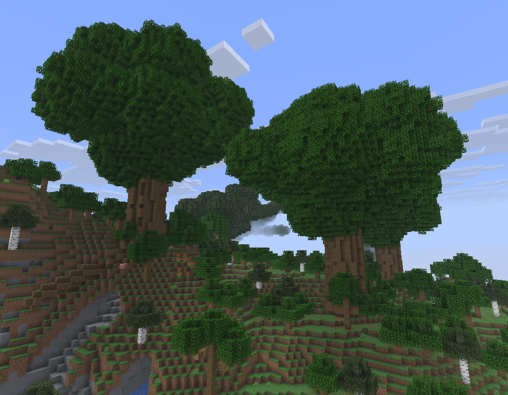

**[Browse every tree in 3D](https://def9a2a4.github.io/GiantTreesX/)**: turn them around, cut into them, and edit tree files in your browser.

A fork of [GiantTrees](https://github.com/rmichela/GiantTrees) by Ryan Michela, maintained by [def9a2a4](https://github.com/def9a2a4). Report bugs [here](https://github.com/def9a2a4/GiantTreesX/issues), not upstream.

|                    Oak                     |                      Pale Oak                      |                     Mangrove                     |                    Cherry                    |
| :----------------------------------------: | :------------------------------------------------: | :----------------------------------------------: | :------------------------------------------: |
| 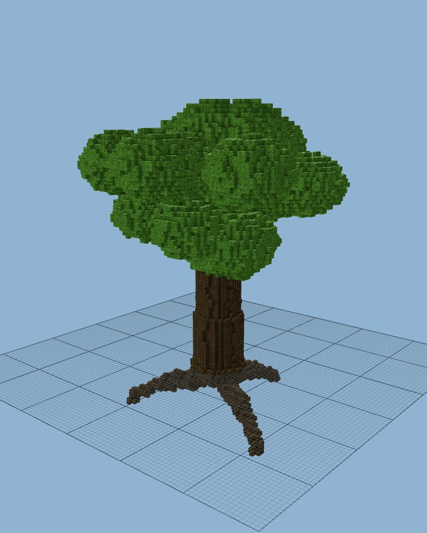     | 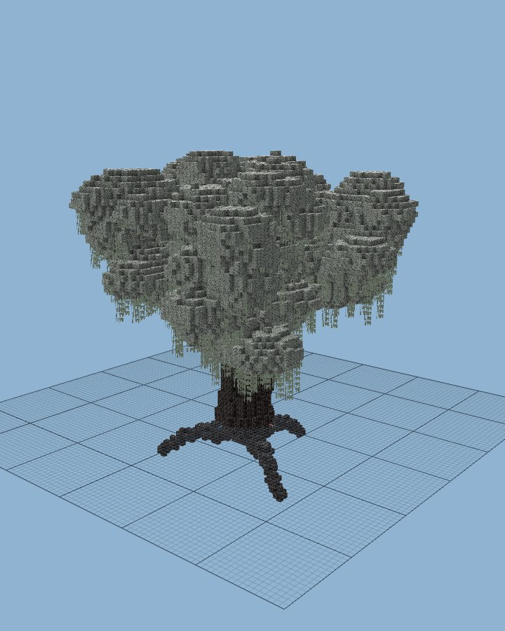   | 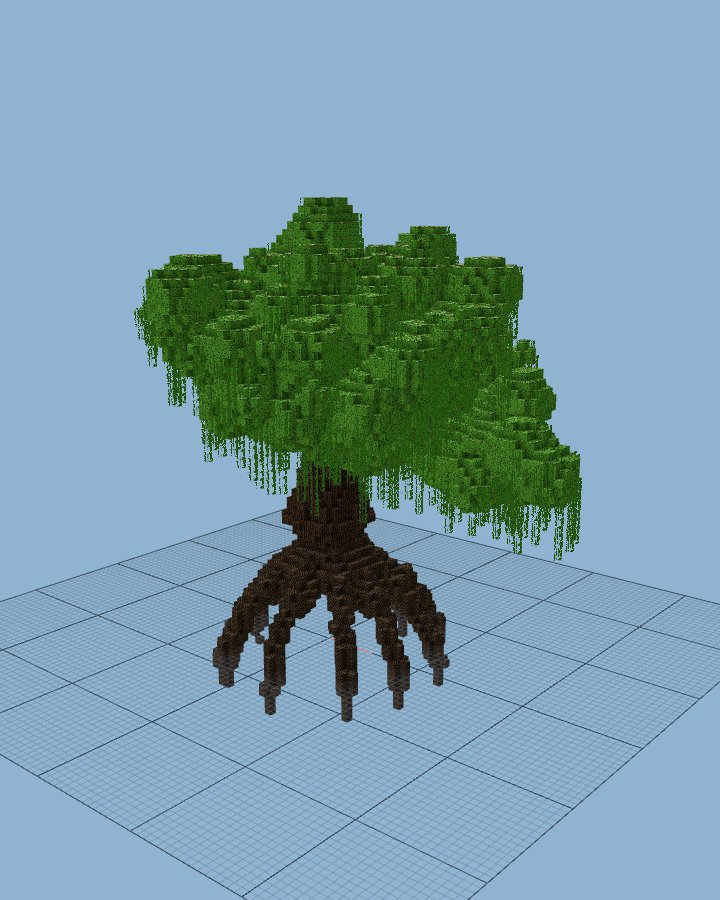 | 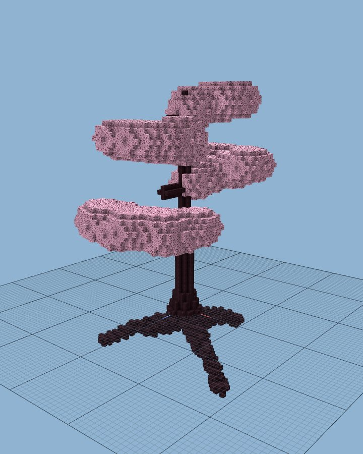 |
|                 **Poplar**                 |                  **Red Mushroom**                  |                **Crimson Fungus**                |                  **Spruce**                  |
| 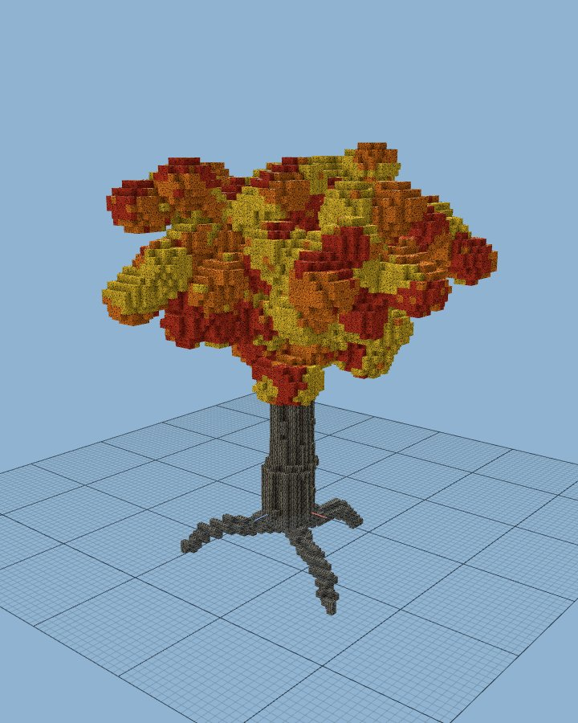 | 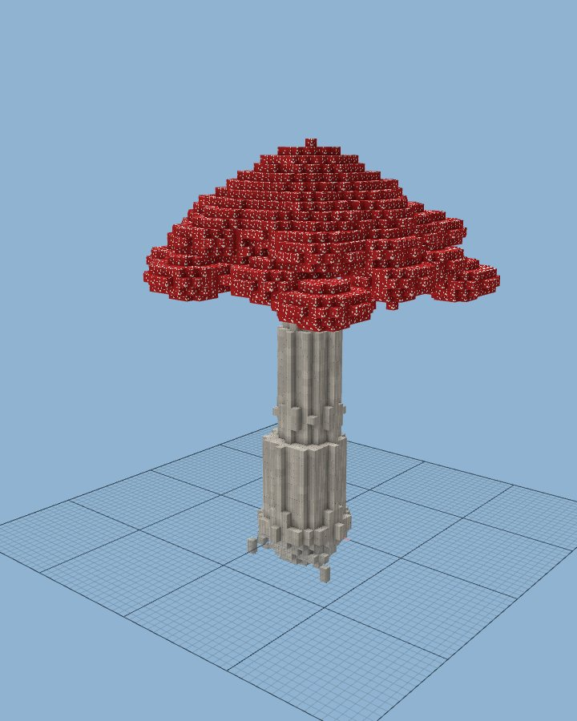 | 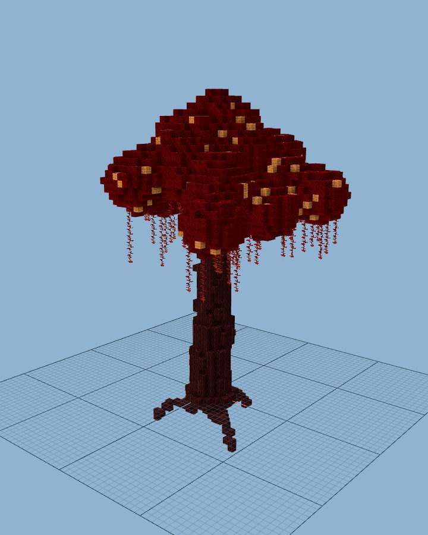 | 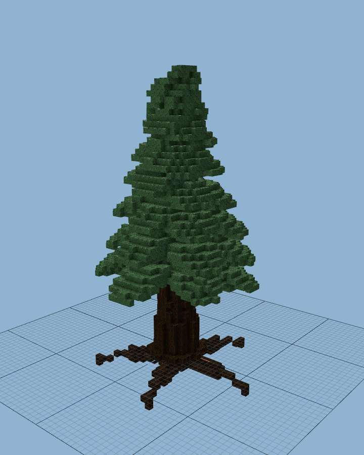 |

> [!WARNING]
> Back up your world. Giant trees replace a lot of blocks, and there is no undo.


# Features

- **18 tree types**: oak, birch, spruce, jungle, acacia, dark oak, cherry, mangrove, pale oak, swamp oak, cottonwood, mesa puzzle, azalea, poplar (26.3+), red and brown mushrooms, crimson and warped fungi.
- **Three sizes**: giant (40–60 blocks tall), huge (25–40) and big (14–24). Jungle and spruce have no big size; vanilla's 2x2 trees cover it.
- **Decorations**: vines, pale moss, weeping vines, muddy mangrove roots, rooted dirt under azaleas.
- **Wood styles**: bark outside and stripped logs inside, plain logs, or logs only. Hollow trunks. Per wood type styles and leaf mixes.
- **Natural leaf decay**: chop the wood and the leaves fall, like vanilla.
- **Natural spawning** per biome: which trees, how often, which sizes.
- **Light on the server**: trees are built off the main thread and placed in small batches.
- **Safe**: never replaces chests, spawners or other block entities, or blocks you protect. Protection plugins that block a click also block growing a tree there.


# Growing Trees

| Giant | Huge | Big |
| :---: | :---: | :---: |
| 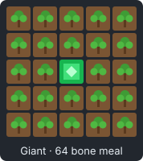 | 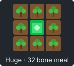 | 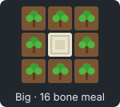 |
| emerald block, 5x5 saplings | emerald block, 3x3 saplings | bone block, 3x3 saplings |

1. Place the core block and plant saplings around it.
2. Right-click the core block holding bone meal. The cost comes out of your inventory.
3. Stand back. The tree appears after 3 seconds.

- Patterns work in any rotation.
- Mixed patterns are listed in [`config.yml`](src/main/resources/config.yml): mesa puzzle, cottonwood, swamp oak and azalea.
- Mushrooms need dim light, or mycelium, podzol or nylium underneath, like vanilla.
- Costs, sizes and patterns are configurable under `planting:`.


# Natural Trees

Trees spawn in new chunks, set in the `natural:` section. A tree name covers all its sizes.

```yaml
natural:
  enabled: true
  worlds: [world]
  chance: 4                       # percent of new chunks with a tree
  sizes: {giant: 1, huge: 4, big: 16}
  trees:
    FOREST: [OAK, COTTONWOOD]
    LUSH_CAVES: [AZALEA]          # above lush caves, in any biome
    PLAINS:                       # per biome chance, weights and sizes
      chance: 0.2
      trees: {OAK: 3, BIRCH: 1}
      sizes: {giant: 0}
```

Trees grow only on soil, never inside another tree, and in water only in swamps. Biome variants share their parent's entry (`FOREST` covers flower forests) unless given their own.


# Commands

`/gianttrees` or `/gt`. Arguments tab-complete; leave one out for clickable choices.

| Command | Does | Permission |
| --- | --- | --- |
| `/gt help` | Commands and links | everyone |
| `/gt grow <type> <size> [x z [world]]` | Grow a tree here, or at a position | `gianttrees.create` (op) |
| `/gt edit <type> <size> [root]` | Open a tree in the Arbaro desktop editor | console |
| bone meal on a sapling pattern | Grow a tree from saplings | `gianttrees.grow` (everyone) |


# Custom Trees

Trees are [Arbaro](https://arbaro.sourceforge.net/) files: `tree.<NAME>.xml`, plus an optional `tree.<NAME>.root.xml` for roots.

1. Open a tree in the **[web viewer](https://def9a2a4.github.io/GiantTreesX/viewer/)**, tweak it, and *Download XML*.
2. Put it in `plugins/GiantTrees/tree/`. It works with `/gt grow` right away.
3. List it under a biome in `natural.trees` to spawn it, or add a pattern in `planting.patterns` to grow it.

A file named like a bundled tree (`tree.OAK.xml`) replaces it.


# Installation

- **Paper 1.21.4–1.21.11 or 26.1–26.3**, one jar. Poplars need 26.3; older servers grow birch instead.
- **Java 21+** (26.x servers need Java 25).
- Spigot and Folia are not supported.

Download from [Modrinth](https://modrinth.com/project/gianttreesx), put it in `plugins/`, restart.

Config lives in `plugins/GiantTrees/config.yml`; your own trees go in `plugins/GiantTrees/tree/`. Bundled trees stay in the jar, so updates bring their latest versions.

Anonymous usage stats go to [bStats](https://bstats.org/plugin/bukkit/GiantTreesX/35220); turn them off in `plugins/bStats/config.yml`.

## Upgrading from GiantTrees

- **Config**: settings moved into `natural:` and `planting:`; old keys are ignored, with a warning. Easiest: delete `config.yml`, restart, copy your changes back.
- **Tree files**: old `tree.*.xml` and `biome.*.xml` in the plugin folder are ignored, with a warning naming changed ones. Move keepers to `plugins/GiantTrees/tree/` (`biome.BIOME-NAME.xml` becomes `tree.NAME.xml`, listed under its biome in `natural.trees`).
- **Old trees** keep their old leaves, which never decay.


# Configuration

Every setting is explained in the [bundled `config.yml`](src/main/resources/config.yml). Restart after changes.

| Section | What it sets |
| --- | --- |
| `natural` | worlds, chance, size weights, trees per biome |
| `planting` | on/off, sizes, particles, bone meal costs, core blocks, patterns |
| `generation-delay` | seconds before a grown tree appears |
| `wood`, `wood_types` | wood style, hollow trunks, leaf mixes |
| `protect_block_entities`, `protected_blocks` | blocks trees never replace |
| `BLOCKS_PER_TICK`, `TICK_DELAY` | placement speed |


# Credits

- **Ryan Michela** ([rmichela](https://github.com/rmichela)): wrote [GiantTrees](https://github.com/rmichela/GiantTrees).
- **Ronald Jack Jenkins Jr.** ([rjenkinsjr](https://github.com/rjenkinsjr)): maintained it around 2016.
- **Capri205** ([Capri205](https://github.com/Capri205)): kept it going 2022–2025: Minecraft 1.18–1.21, the mangrove, mesa puzzle, cottonwood and cherry trees, custom patterns, several trees per biome.
- **Wolfram Diestel**: [Arbaro](https://arbaro.sourceforge.net/), the tree generator, based on Weber and Penn's *Creation and Rendering of Realistic Trees* (SIGGRAPH 1995; [ACM](https://dl.acm.org/doi/10.1145/218380.218427), [PDF](https://courses.cs.duke.edu/cps124/fall01/resources/p119-weber.pdf)).
- **John Kennedy** (Santa Monica College): integer drawing of [lines](https://web.archive.org/web/20070418050210/http://homepage.smc.edu/kennedy_john/BRESENL.PDF), [circles](https://web.archive.org/web/20120917053124/http://homepage.smc.edu/kennedy_john/BCIRCLE.PDF) and [ellipses](https://web.archive.org/web/20121202050041/http://homepage.smc.edu:80/kennedy_john/BELIPSE.PDF).


# License

**[GPLv3](LICENSE)** or later, like GiantTrees.

| Component | Where | License |
| --- | --- | --- |
| GiantTrees | the plugin's code | GPLv3+ |
| Arbaro (Wolfram Diestel), modified | `src/arbaro/`, in the jar | GPLv2+, redistributed under GPLv3+ ([`NOTICE`](src/main/resources/NOTICE)) |
| Tree files | `src/main/resources/tree/`, in the jar | GPLv3+ |
| [bStats](https://bstats.org/) | in the jar, relocated | MIT |
| [three.js](https://threejs.org/) r160 | `docs/viewer/vendor/`, website only | MIT ([`LICENSE`](docs/viewer/vendor/LICENSE)) |
| [Paper API](https://papermc.io/) | compiled against, not included | GPLv3 / MIT |
| [Playwright](https://playwright.dev/) | renders gallery images, dev only | Apache 2.0 |

The viewer's textures are drawn by code; no Minecraft assets are included. Not affiliated with Mojang or Microsoft.


# Developing

Needs **Java 21** and **Maven**. `mvn package` builds `target/GiantTrees-<version>.jar`.

- `make server`: local Paper test server (`MINECRAFT_VERSION=1.21.11` for another version). `make server-test`: the integration test CI runs.
- `make preview`: serve the gallery and viewer from `docs/`. `make gallery`: re-render the gallery. See [`docs/viewer/README.md`](docs/viewer/README.md).
- `make readme-absolute`: print this README with absolute links, for Modrinth.
- [`scripts/`](scripts/README.md): tools for tuning tree files.
